# Analyst findings for the available NYC 311 snapshot

These findings describe **100,000 requests** created between **2026-10-14 11:19:47** and **2026-10-23 02:46:57**. All 15 investigations use the same unfiltered local snapshot. There are **69,263 valid non-negative durations** and **69,382 recorded closures**.

The source is the earlier local `data\cleaned\nyc_cleaned.csv`, not the later Colab extract shown in notebook 04. Its genuine extraction metadata was not supplied; the creation window is known, but the download time and API parameters are unverified. Results below were recalculated in Python and are not presented as newly executed MySQL query results. Recompute them when the final canonical extract and matching MySQL table are ready.

Source SHA-256: `80502bf0307c77c3f2ece33ea97ec6a126d34b7b82d6ed1a129c06293dd8a7be`. See [provenance](analysis_provenance.json), [completed evidence table](analyst_evidence.csv), and the [reproduction script](../../../../scripts/05_write_analyst_findings.py).

Closure means a recorded closed timestamp, even if its chronology is invalid. Duration analysis requires valid creation and closure timestamps with closure at or after creation. Missing location values are not imputed. Charts and aggregate result tables accompany every investigation.

## 01 distinct volume

What is the total distinct request volume?

**Sample:** 100,000. Total filtered rows: 100,000; valid-duration sample: 69,263.

**Observation:** The extract contains 100,000 rows and 100,000 distinct request IDs. Creation timestamps span 2026-10-14 11:19:47 to 2026-10-23 02:46:57; 100,000 rows have usable creation dates.

**Cautious interpretation:** This is the volume of the supplied snapshot, not all NYC requests or unique incidents. Multiple requests can describe the same problem. The extraction timestamp and API parameters were not supplied for this local file; creation coverage does not establish when it was downloaded.

[Calculation](../../../../scripts/05_write_analyst_findings.py) · [SQL reference](../../../../sql/01_distinct_volume.sql) · [Aggregate result](analysis/01_distinct_volume.csv)

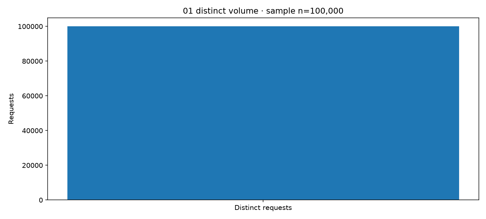

## 02 top complaints

Which 10 complaint categories are most frequent?

**Sample:** 100,000. Total filtered rows: 100,000; valid-duration sample: 69,263.

**Observation:** The leading categories are ILLEGAL PARKING (16,398); HEAT/HOT WATER (11,692); NOISE - RESIDENTIAL (8,971). The top ten account for 58,665 requests (58.66%); ILLEGAL PARKING alone accounts for 16.40%.

**Cautious interpretation:** These categories are candidates for workload review, but reporting frequency, repeated complaints and category definitions affect counts. A high complaint count does not establish the underlying prevalence or severity of a problem.

[Calculation](../../../../scripts/05_write_analyst_findings.py) · [SQL reference](../../../../sql/02_top_complaints.sql) · [Aggregate result](analysis/02_top_complaints.csv)

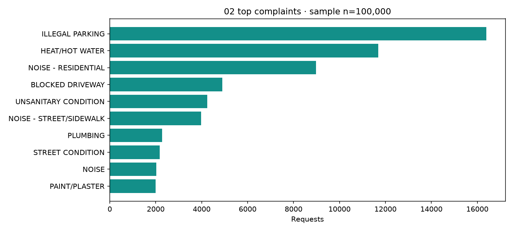

## 03 agency workload

How is workload distributed across agencies?

**Sample:** 100,000. Total filtered rows: 100,000; valid-duration sample: 69,263.

**Observation:** The largest recorded agency workloads are NYPD (41,731); HPD (27,979); DSNY (7,237). These three agencies receive 76.95% of the sample.

**Cautious interpretation:** Counts describe assigned requests rather than staff effort, capacity or performance. Agencies handle different case types and complexity; staffing recommendations would require workload and resource measures beyond request totals.

[Calculation](../../../../scripts/05_write_analyst_findings.py) · [SQL reference](../../../../sql/03_agency_workload.sql) · [Aggregate result](analysis/03_agency_workload.csv)

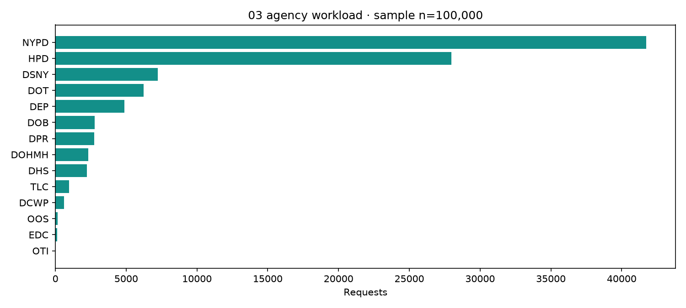

## 04 borough volume

How does request volume vary by borough?

**Sample:** 100,000. Total filtered rows: 100,000; valid-duration sample: 69,263.

**Observation:** The largest borough counts are BROOKLYN (32,779); QUEENS (22,303); MANHATTAN (21,831). BROOKLYN represents 32.78% of all requests.

**Cautious interpretation:** Raw borough counts are not population-adjusted rates. Population, visitors, reporting access and the mix of services can explain differences; do not conclude that the largest count identifies the worst-performing borough.

[Calculation](../../../../scripts/05_write_analyst_findings.py) · [SQL reference](../../../../sql/04_borough_volume.sql) · [Aggregate result](analysis/04_borough_volume.csv)

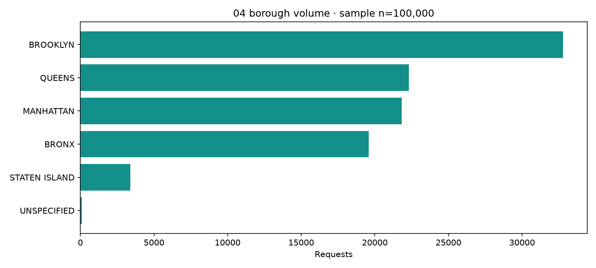

## 05 monthly trend

How does request volume change by month?

**Sample:** 100,000. Total filtered rows: 100,000; valid-duration sample: 69,263.

**Observation:** The extract covers 1 calendar month(s), with 100,000 dated requests. Coverage begins 2026-10-14 11:19:47 and ends 2026-10-23 02:46:57; the monthly series does not contain a full set of comparable months.

**Cautious interpretation:** No month-to-month or seasonal conclusion is supported by this short, partial-month sample. Obtain complete comparable months before assessing growth, decline or seasonality.

[Calculation](../../../../scripts/05_write_analyst_findings.py) · [SQL reference](../../../../sql/05_monthly_trend.sql) · [Aggregate result](analysis/05_monthly_trend.csv)

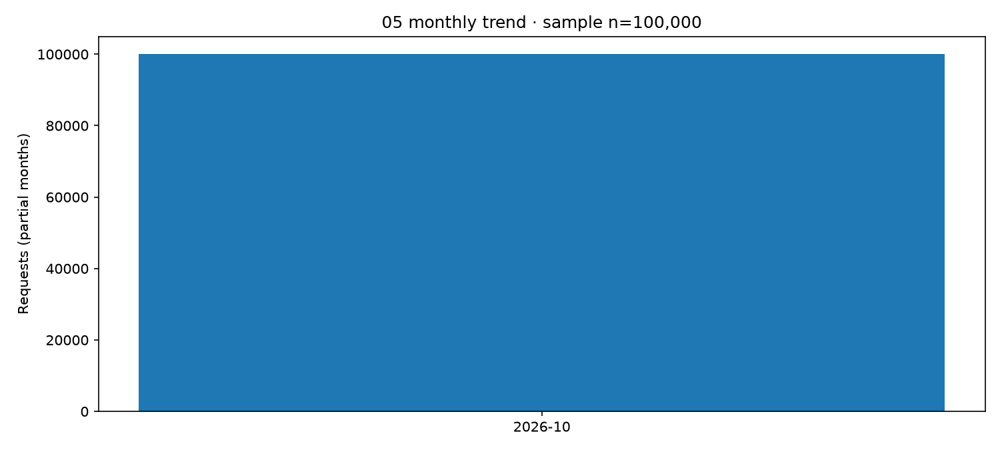

## 06 weekday hour

When (weekday and hour) is demand highest?

**Sample:** 100,000. Total filtered rows: 100,000; valid-duration sample: 69,263.

**Observation:** Thursday has the largest pooled weekday count (22,084); the busiest pooled hour is 11:00–11:59 (6,113 requests, 6.11% of dated records). The weekday/hour table contains the full cross-tabulation.

**Cautious interpretation:** Pooled weekday totals have unequal exposure: some weekdays occur more often in this short window, and boundary days are partial. Hourly counts can reflect reporting behaviour as well as incident timing. Use complete days and per-day exposure before proposing staffing changes.

[Calculation](../../../../scripts/05_write_analyst_findings.py) · [SQL reference](../../../../sql/06_weekday_hour.sql) · [Aggregate result](analysis/06_weekday_hour.csv)

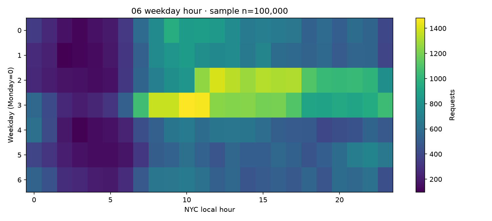

## 07 status distribution

How are recorded statuses distributed?

**Sample:** 100,000. Total filtered rows: 100,000; valid-duration sample: 69,263.

**Observation:** The most frequent recorded statuses are CLOSED (66,944); OPEN (21,119); IN PROGRESS (11,639). Separately, 69,382 rows (69.38%) have a closure timestamp; source status labels have been preserved.

**Cautious interpretation:** A recorded status and the existence of a closed timestamp are different fields and may disagree. Neither verifies satisfaction or independently confirmed resolution. Do not overwrite source statuses just to make them match the closure indicator.

[Calculation](../../../../scripts/05_write_analyst_findings.py) · [SQL reference](../../../../sql/07_status_distribution.sql) · [Aggregate result](analysis/07_status_distribution.csv)

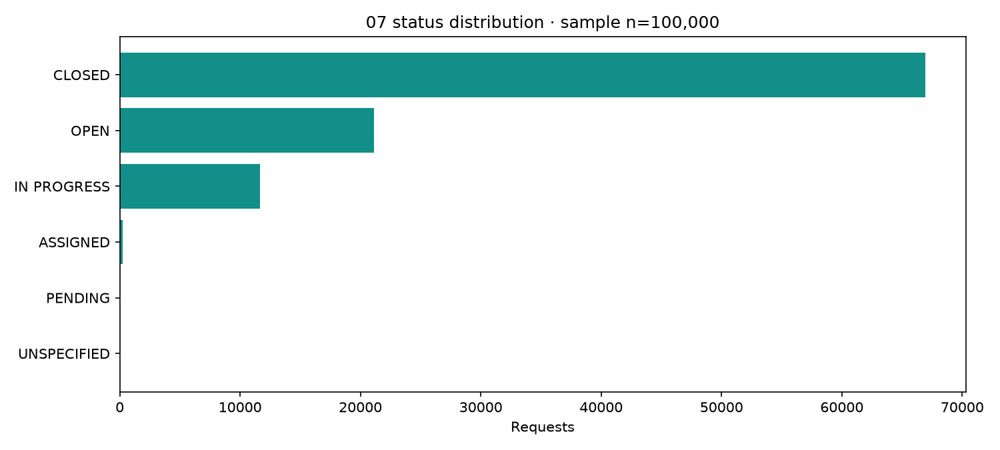

## 08 resolution statistics

What are the descriptive statistics of valid resolution durations?

**Sample:** 69,263. Total filtered rows: 100,000; valid-duration sample: 69,263.

**Observation:** Among 69,263 valid durations, mean resolution is 16.32 h and median is 2.64 h. Q1=0.74 h, Q3=18.05 h, sample SD=29.63 h, and range=0.00–199.47 h. 119 negative chronological durations are excluded.

**Cautious interpretation:** These statistics describe observed valid closed cases only. Open cases have no final duration and are excluded, creating incomplete-follow-up bias in a recent extract. Report the median alongside the mean and retain invalid-date counts as a quality limitation.

[Calculation](../../../../scripts/05_write_analyst_findings.py) · [SQL reference](../../../../sql/08_resolution_statistics.sql) · [Aggregate result](analysis/08_resolution_statistics.csv)

## 09 category median

What is the median resolution duration by complaint category?

**Sample:** 69,263. Total filtered rows: 100,000; valid-duration sample: 69,263.

**Observation:** The largest observed category median is CURB CONDITION: 146.55 h, based on 16 valid durations from 260 requests. The accompanying table reports both counts for every category with a valid duration.

**Cautious interpretation:** The largest median is not a reliable performance ranking. Some categories have very few valid closed cases relative to incoming volume, and service complexity differs. Inspect the valid counts and closure coverage, and use minimum-sample rules before comparing categories.

[Calculation](../../../../scripts/05_write_analyst_findings.py) · [SQL reference](../../../../sql/09_category_median.sql) · [Aggregate result](analysis/09_category_median.csv)

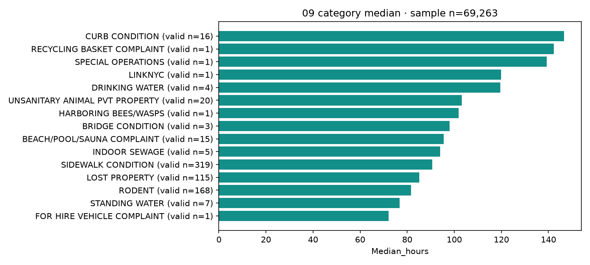

## 10 agency median

What is the median resolution duration by agency?

**Sample:** 69,263. Total filtered rows: 100,000; valid-duration sample: 69,263.

**Observation:** The largest observed agency median is OTI: 119.83 h from 1 valid durations (8 requests). The table retains valid-duration denominators for each agency.

**Cautious interpretation:** Agency medians reflect different case mixes and closure coverage. A very small valid sample can produce an unstable apparent maximum; do not infer that the agency is intrinsically slower or less effective.

[Calculation](../../../../scripts/05_write_analyst_findings.py) · [SQL reference](../../../../sql/10_agency_median.sql) · [Aggregate result](analysis/10_agency_median.csv)

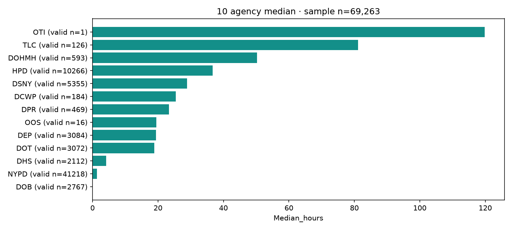

## 11 iqr outliers

Which durations fall outside the 1.5 × IQR fences?

**Sample:** 69,263. Total filtered rows: 100,000; valid-duration sample: 69,263.

**Observation:** Tukey fences are -25.23 h and 44.02 h (IQR=17.31 h). 9,250 of 69,263 valid durations (13.35%) lie outside the fences. No cases are deleted by this screening.

**Cautious interpretation:** IQR flags are prompts for case review, not proof of errors or SLA breaches. Long cases may be legitimate and should remain in the main analysis. The fences depend on this particular sample and its observed closed cases.

[Calculation](../../../../scripts/05_write_analyst_findings.py) · [SQL reference](../../../../sql/11_iqr_outliers.sql) · [Aggregate result](analysis/11_iqr_outliers.csv)

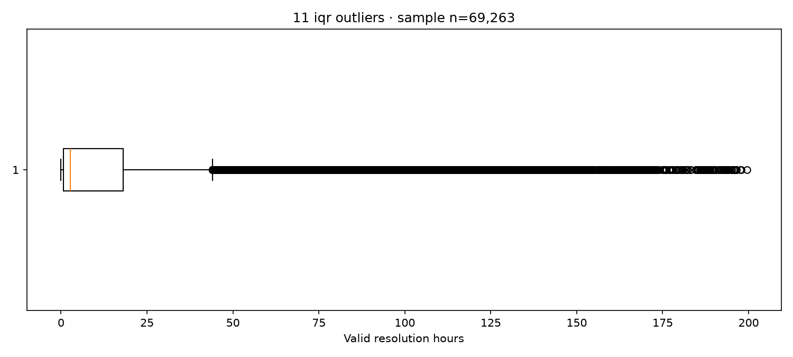

## 12 duration distribution

What is the shape of the duration distribution?

**Sample:** 69,263. Total filtered rows: 100,000; valid-duration sample: 69,263.

**Observation:** Sample skewness is 2.727; mean=16.32 h versus median=2.64 h. The histogram contains all 69,263 valid durations, including its long-duration tail.

**Cautious interpretation:** The positive skew and difference between mean and median indicate that long cases pull the average upward in this sample. The median better summarizes its central closed-case duration, while tail behaviour remains operationally relevant; unclosed cases are still absent from the distribution.

[Calculation](../../../../scripts/05_write_analyst_findings.py) · [SQL reference](../../../../sql/12_duration_distribution.sql) · [Aggregate result](analysis/12_duration_distribution.csv)

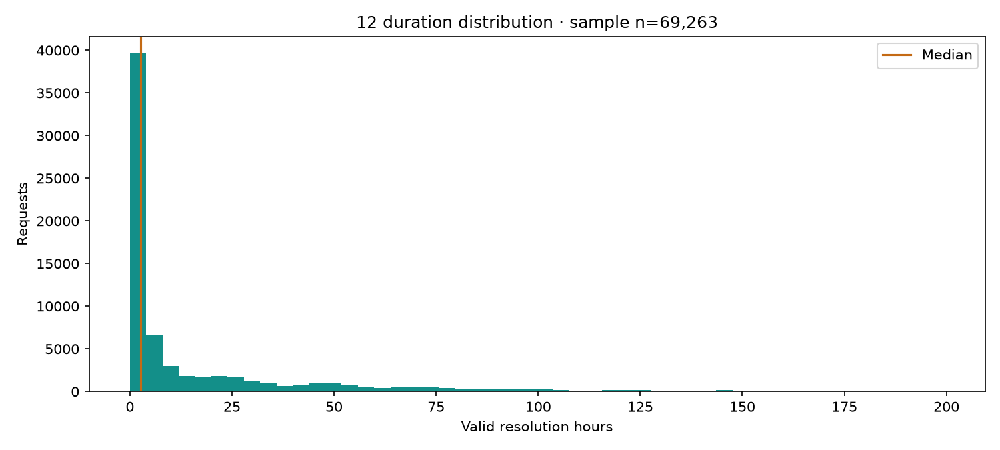

## 13 geographic concentration

Where are complaints geographically concentrated using usable coordinates?

**Sample:** 98,415. Total filtered rows: 100,000; valid-duration sample: 69,263.

**Observation:** 98,415 of 100,000 requests (98.42%) have usable coordinates inside the approximate NYC bounds. The busiest rounded 0.01-degree cell is latitude 40.65, longitude -73.96, with 865.0 requests.

**Cautious interpretation:** Rounded cells are approximate angular grid cells, not neighbourhoods or official boundaries. Repeated reports, reporting density and missing coordinates affect apparent concentration. Imputed coordinates are excluded when flags exist; the earlier local file lacks full imputation provenance, so geographic findings remain exploratory.

[Calculation](../../../../scripts/05_write_analyst_findings.py) · [SQL reference](../../../../sql/13_geographic_concentration.sql) · [Aggregate result](analysis/13_geographic_concentration.csv)

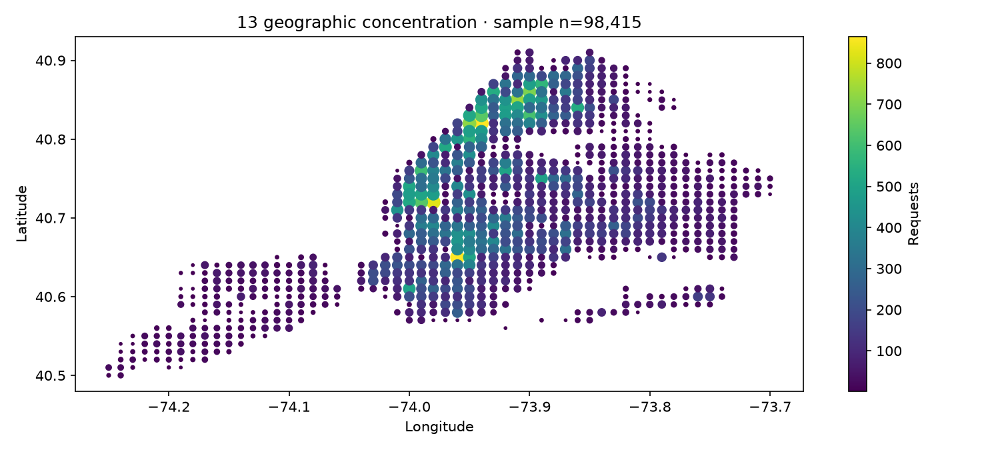

## 14 closure rate

How do recorded closure rates compare across boroughs?

**Sample:** 100,000. Total filtered rows: 100,000; valid-duration sample: 69,263.

**Observation:** Overall recorded closure is 69,382/100,000 (69.38%). Borough-specific numerators, denominators and percentages are in the result table. The highest displayed group is QUEENS: 16,457/22,303 (73.79%).

**Cautious interpretation:** Closure-rate differences do not establish service quality. Request age, agency/category mix, inconsistent timestamps and follow-up length can affect comparisons. Rows with impossible closure chronology still count as recorded closure under the stated KPI definition, but never as valid durations.

[Calculation](../../../../scripts/05_write_analyst_findings.py) · [SQL reference](../../../../sql/14_closure_rate.sql) · [Aggregate result](analysis/14_closure_rate.csv)

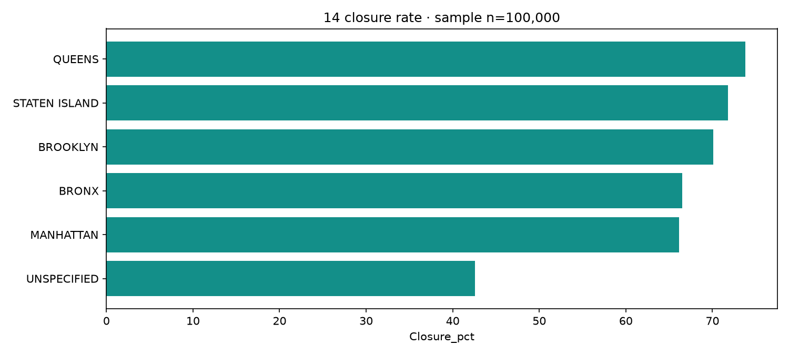

## 15 high volume slow categories

Which categories have both high volume and long median duration?

**Sample:** 69,263. Total filtered rows: 100,000; valid-duration sample: 69,263.

**Observation:** 36 categories meet at least 100 requests and median duration of at least 24 h. The highest-volume qualifying category is HEAT/HOT WATER: 11,692 requests, 7,054 valid durations and median 32.71 h.

**Cautious interpretation:** The 100-request and 24-hour cut-offs are project choices, not official service standards. High total volume does not guarantee a large valid-duration sample; use the valid count and closure coverage when selecting categories for further investigation rather than treating this as a definitive priority ranking.

[Calculation](../../../../scripts/05_write_analyst_findings.py) · [SQL reference](../../../../sql/15_high_volume_slow_categories.sql) · [Aggregate result](analysis/15_high_volume_slow_categories.csv)

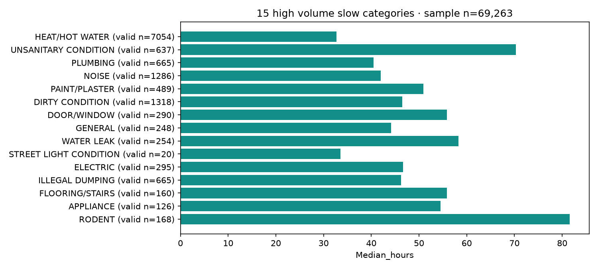
