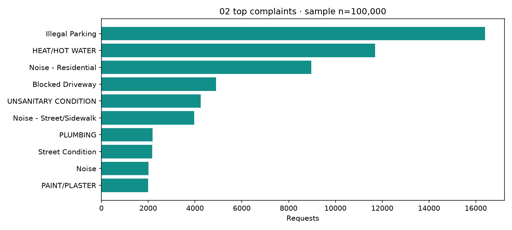
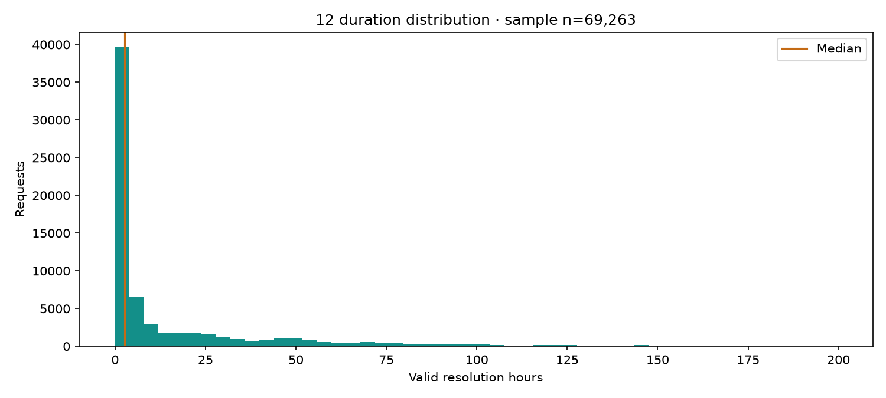
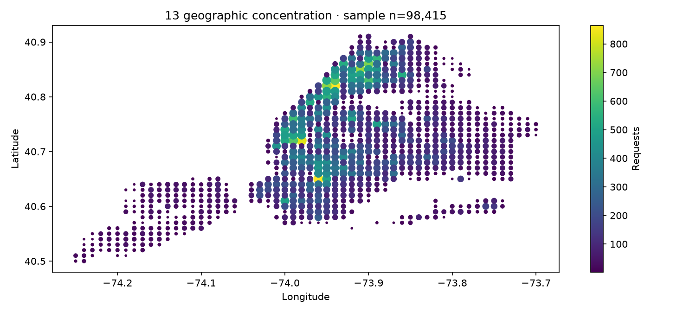

# UrbanPulse NYC final findings report

Citizen complaint intelligence and recorded closure analytics  
Report date: 6 November 2026  
Creation coverage: 14 October 2026 at 11:19:47 to 23 October 2026 at 02:46:57, NYC local time

## Executive findings

The available snapshot contains **100,000 distinct service requests**. Demand is concentrated: Illegal Parking is the largest category with 16,398 requests, and the ten leading categories account for 58.57% of the extract. NYPD, HPD and DSNY together account for 76.95% of recorded agency workload. Brooklyn has the largest borough count, with 32,779 requests.

Among **69,263 valid recorded closure durations**, the median is **2.64 hours**, compared with a mean of **16.32 hours**. This difference, together with sample skewness of 2.727, shows a pronounced right tail. The overall median therefore obscures substantial differences between service categories and agencies. HEAT/HOT WATER combines high volume with a longer median: 11,692 requests and a 32.71-hour median among 7,054 valid durations.

These findings support targeted investigation of service demand and long-duration cases. They do not establish agency effectiveness, citizen satisfaction, official SLA compliance or the prevalence of underlying urban problems. The sample covers approximately nine days, and many requests remain without a recorded closure.

## Data and analytical scope

The analysis uses the earlier local file `data/cleaned/nyc_311_cleaned.csv`. Its SHA-256 is `0a2b7f6121e2db9940ec54e5baff0a2d263cf7a45018bcd0e2ff7854864ab417`. The [provenance record](analysis_provenance.json) identifies its coverage, counts and calculation time.

The file contains 100,000 rows, 100,000 unique request identifiers and no missing creation timestamps after parsing. No date, borough or complaint-category filters were applied. The creation window describes when requests were created; the original download timestamp, API parameters and extraction metadata were not supplied for this file.

The 15 investigations were recalculated in Python using the dashboard's shared definitions. SQL references are provided alongside their evidence, but this report does not claim a new MySQL execution. The saved MySQL notebook describes a different, later extract; its results must not be combined with these figures.

Recorded closure means a parsed closed timestamp exists. A valid duration additionally requires a valid creation timestamp and closure at or after creation. Source statuses are preserved. Missing coordinates are not filled during this analysis. The [completed evidence table](analyst_evidence.csv) links each question to its calculation, SQL reference, sample size, result table, visualization, observation and cautious interpretation.

## Five dashboard KPIs

| KPI | Result | Definition and denominator |
|---|---:|---|
| Total requests | 100,000 | Distinct request identifiers in the unfiltered snapshot |
| Recorded closure | 69.38% | 69,382 rows with a recorded closed timestamp / 100,000 rows |
| Open requests | 30,618 | Rows without a recorded closed timestamp; independent of source status label |
| Median resolution | 2.64 hours | Median of 69,263 valid non-negative durations |
| Over 72 hours | 6.4% | 4,402 / 69,263 valid durations strictly greater than 72 hours, rounded to one decimal |

The 72-hour cut-off is an illustrative project threshold, not a verified official service standard. Recorded closure includes 119 rows whose closure precedes creation; those rows are excluded from duration calculations. Consequently, the closure numerator and valid-duration denominator differ.

## Service demand and workload

### Complaint categories

Illegal Parking contributes 16,398 requests (16.40%), followed by HEAT/HOT WATER with 11,692 (11.69%) and Noise - Residential with 8,971 (8.97%). The top ten categories contribute 58,573 requests. These concentrations identify useful starting points for reviewing incoming demand and category-specific workflows.

Counts are reports, not independently verified incidents. Multiple people may report one issue, and reporting access and category definitions can influence the distribution. High volume alone does not establish severity or justify a resource allocation decision.



### Agency and borough distribution

| Agency | Requests | Share of snapshot |
|---|---:|---:|
| NYPD | 41,731 | 41.73% |
| HPD | 27,979 | 27.98% |
| DSNY | 7,237 | 7.24% |

Brooklyn contributes 32,779 requests (32.78%), Queens 22,303 (22.30%), Manhattan 21,831 (21.83%), the Bronx 19,597 (19.60%) and Staten Island 3,382 (3.38%). Another 108 rows have an unspecified borough.

Agency counts measure assigned request volume rather than staff hours or operational capacity. Borough counts are not adjusted for population, visitors or service mix, so neither distribution is a performance ranking.

### Temporal demand

All 100,000 requests fall within part of October 2026. A monthly total is available, but there are no comparable full months from which to infer a trend or seasonality.

Thursday has the largest pooled weekday count, 22,084. The busiest pooled hour is 11:00–11:59, with 6,113 requests (6.11%). Weekday exposure is unequal in this short window, and the first and last days are partial. These totals should be normalized using complete observation days before informing staffing schedules. Reporting time may also differ from incident time.

## Recorded closure and resolution duration

The source status field records 66,944 rows as Closed, while 69,382 rows have a closure timestamp. This difference shows why recorded status and the dashboard's timestamp-based closure measure must remain separate.

| Duration statistic | Hours |
|---|---:|
| Mean | 16.32 |
| Median | 2.64 |
| First quartile | 0.74 |
| Third quartile | 18.05 |
| Interquartile range | 17.31 |
| Sample standard deviation | 29.63 |
| Minimum | 0.00 |
| Maximum | 199.47 |

The valid-duration sample is 69,263. Sample variance is 878.19 hours squared; the mode is zero hours. Zero-duration cases warrant checking against agency recording practices rather than assuming instantaneous service.

The mean is approximately six times the median, reflecting a long upper tail. Tukey's 1.5-IQR fences are −25.23 and 44.02 hours; 9,250 valid durations (13.35%) fall outside them. Because valid durations are non-negative, these flagged cases are above the upper fence. They are retained: an outlier can be a legitimate long-running case rather than a data error.



### Category and agency comparisons

Thirty-six categories meet the exploratory thresholds of at least 100 total requests and at least 24 median hours. The highest-volume candidates are:

| Category | Total requests | Valid durations | Median hours |
|---|---:|---:|---:|
| HEAT/HOT WATER | 11,692 | 7,054 | 32.71 |
| UNSANITARY CONDITION | 4,249 | 637 | 70.31 |
| PLUMBING | 2,186 | 573 | 46.87 |
| Noise | 2,019 | 1,286 | 42.02 |
| PAINT/PLASTER | 2,002 | 489 | 50.94 |

These are candidates for case review, not a definitive intervention ranking. For example, only 637 of 4,249 UNSANITARY CONDITION requests contribute valid durations, making its observed median sensitive to which cases have closed.

NYPD has a 1.31-hour median among 41,218 valid durations; HPD has a 36.65-hour median among 10,266; DSNY has a 28.84-hour median among 5,355. Different responsibilities, case complexity, recording practices and follow-up prevent direct conclusions about comparative effectiveness. OTI's apparent 119.83-hour median is based on one valid duration from eight requests and is particularly unstable.

### Borough closure rates

| Borough | Recorded closures | Requests | Recorded closure rate |
|---|---:|---:|---:|
| Queens | 16,457 | 22,303 | 73.79% |
| Staten Island | 2,428 | 3,382 | 71.79% |
| Brooklyn | 22,977 | 32,779 | 70.10% |
| Bronx | 13,029 | 19,597 | 66.48% |
| Manhattan | 14,445 | 21,831 | 66.17% |
| Unspecified | 46 | 108 | 42.59% |

Queens has the highest observed rate among named boroughs, but the comparison is not adjusted for request age or agency/category mix. A recorded closure is not evidence of citizen satisfaction or independently verified resolution.

## Geographic concentration

There are 98,415 coordinate-usable records (98.42%) within the approximate screening box of latitude 40.4–41.0 and longitude −74.3 to −73.7. The remaining 1,585 records do not meet this coordinate screen. The busiest rounded 0.01-degree cell is centred on the rounded coordinates 40.65, −73.96, with 865 requests; the next two contain 863 and 826 requests.



These cells are approximate angular groupings, not neighbourhoods or official administrative boundaries. Their counts are not population-adjusted densities. Imputed coordinates are excluded when flags are available, but this earlier file lacks full imputation provenance. Spatial patterns should therefore remain exploratory until checked against the raw source and a documented cleaning history.

## Recommended next actions

1. **Review high-volume, longer-duration categories.** Begin with the five categories above, checking case age, valid-duration coverage and representative records before proposing operational changes. Evaluate closure-age cohorts as well as closed-case medians.
2. **Investigate chronology and recording anomalies.** Trace the 119 negative-duration records to source timestamps and review zero-duration cases and status/closure inconsistencies. Preserve flags and source values rather than silently correcting them.
3. **Retain the tail in performance reporting.** Display medians, valid counts and upper-tail measures together. Review the 9,250 IQR-flagged cases without automatically deleting them or labelling them SLA breaches.
4. **Extend temporal and geographic evidence.** Collect complete comparable weeks and months, normalize weekday exposure, and validate coordinate provenance before drawing seasonal conclusions or identifying local intervention areas.
5. **Reconcile the final submission snapshot.** Preserve genuine extraction metadata, rerun the reviewed preparation workflow and MySQL load, and regenerate all results from the same final dataset before presenting the work as a fully reproduced end-to-end submission.

## Limitations and reproducibility

This report is descriptive. NYC 311 records represent reported requests and do not capture all urban problems. The short creation window and incomplete follow-up exclude unresolved cases from duration statistics. Differences between categories, agencies and boroughs may reflect case mix and recording practices. No causal explanation, staffing requirement or official service target has been established.

The project includes API extraction, preparation, statistics and MySQL notebooks; 15 SQL reference files; a Streamlit application with shared filters and five KPIs; and the accompanying written evidence. For this report, calculations were executed against the identified local CSV. A new live API extraction and MySQL roundtrip were not performed, and the raw download provenance of this earlier file is unavailable. This describes the initial report execution; see the subsequent MySQL verification below.

Subsequently, the changed preparation and statistics notebooks were rerun from the preserved raw snapshot, and the dashboard and 15 Python investigations were validated against the newly prepared canonical CSV. The five headline KPIs agree with this report. See the [fresh execution summary](execution/20261106_153641/summary.md) for saved outputs and hashes. The live API attempt stalled and was terminated; a successful fresh download and current MySQL roundtrip are still not established.

Reproduce the supporting evidence with:

```powershell
python scripts/05_write_analyst_findings.py --source data/cleaned/nyc_311_cleaned.csv
```

That command regenerates the detailed evidence, aggregate CSVs, charts and provenance; this final narrative report is maintained separately. If the source changes, update its figures and interpretations after reviewing the regenerated evidence. See [all 15 investigations](analyst_findings.md), [the evidence table](analyst_evidence.csv), [validation scope](../docs/validation.md) and [project setup](../README.md).

## Subsequent MySQL verification

On 6 November 2026, notebook 04 completed against MySQL 8.4.11 using the current canonical prepared CSV. Verified TLS, the 100,000-row source/cleaned/staged/published reconciliation, full field-by-field read-back validation and publication all passed. All 15 SQL investigations executed and agreed with independent pandas calculations within the recorded numeric precision. The written findings therefore agree with the executed SQL results for this snapshot. The previous published table was preserved as a backup. See the [MySQL execution summary](execution/20261106_163637/summary.md) and [SQL/Python comparison](execution/20261106_163637/sql_python_comparison.json). Original extraction provenance remains the outstanding limitation.
